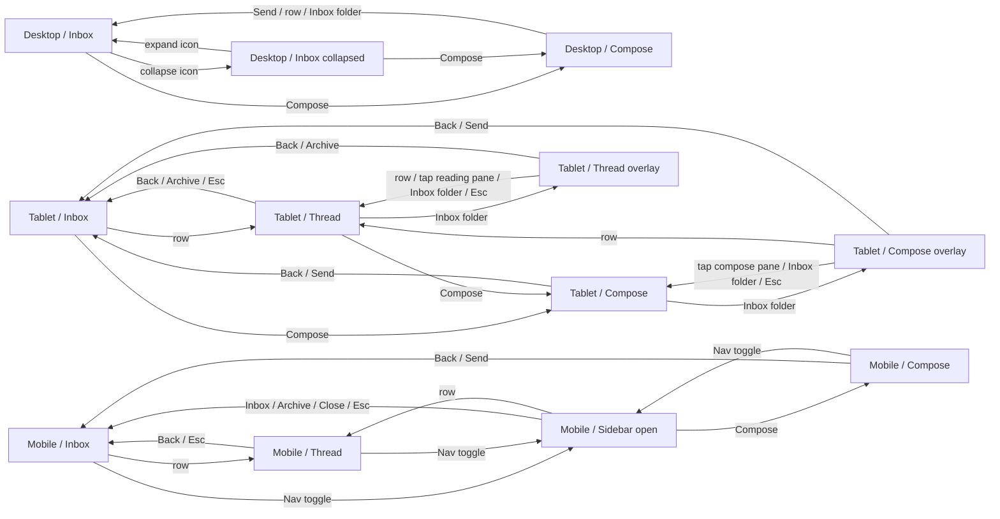

# Mail client design spec
Source: `apps/mail_client/design/mail_client.figcraft` · synced 2026-11-11

## Fidelity contract

- Implement the design at 100% fidelity. Every value in this spec is binding and matches the design 1:1: spacing, sizes, radii, colours, typography, icon sizes, tap targets, layout behaviour and interactions.
- Do not approximate. Do not substitute values. "Close enough" is a defect.
- Use tokens by name in code, never their raw values.
- Raise any deviation (platform limit, missing token, ambiguity) and record it under Open issues before shipping. Do not decide it silently.
- Verify each screen against a FigCraft screenshot of the same frame at the same size.

Notation: `pad[t,r,b,l]`; sizing `W/H` = `fixed` | `hug` | `fill`; all values px.

## Tokens

Source of truth: `apps/mail_client/design/tokens.json` (W3C DTCG 2025.10). The frontend reads its tokens from that file; the FigCraft `Mail` collection is synced from it (spec-compare: 40 in sync, 0 drift). DTCG paths mirror the design names (`surface.nav` ↔ `surface/nav`).

One mode. Names are design-side; map them 1:1 to Dart constants.

| Token | Value | Token | Value |
|---|---|---|---|
| `surface/nav` | `#F3EEE6` | `accent/default` | `#0F6E66` |
| `surface/list` | `#FAF7F2` | `accent/on` | `#FFFFFF` |
| `surface/reading` | `#FFFDF9` | `avatar/bg` | `#E9D8C4` |
| `surface/selected` | `#E3EDEA` | `avatar/fg` | `#6B4F33` |
| `surface/field` | `#FFFFFF` | `radius/sm` | 8 |
| `text/primary` | `#1F1B16` | `radius/md` | 12 |
| `text/muted` | `#7A7064` | `radius/lg` | 16 |
| `border/hairline` | `#E8E1D6` | `radius/pill` | 999 |

Spacing: `space/2 · 4 · 8 · 10 · 12 · 14 · 16 · 20 · 24 · 32 · 40 · 56` = the same px values. Every gap, padding and radius in masters and screens is bound to one of these; zero values are unbound.

Size tokens (every fixed width/height in masters and screens is bound to one of these; hug/fill sizes and icon glyph geometry are not tokens):

| Token | Value | Use |
|---|---|---|
| `size/icon` | 20 | Icon frame, W and H (every `Icon / *`) |
| `size/avatar` | 40 | Avatar, W and H |
| `size/control/sm` | 40 | Search bar height |
| `size/control/md` | 44 | Button / Primary, Folder row, Back link heights; icon-only controls W and H (Nav toggle, sidebar hit areas, Close, icon-only button and folders); mobile nav label rows |
| `size/control/lg` | 48 | Reply bar height |
| `sidebar/width/expanded` | 200 | Sidebar Expanded width |
| `sidebar/width/collapsed` | 64 | Sidebar Collapsed width |
| `pane/list/width/desktop` | 380 | Thread list pane, desktop |
| `pane/list/width/tablet` | 300 | Thread list overlay, tablet |
| `search/width/desktop` | 480 | Search bar, desktop top bar |
| `reading/body/maxWidth` | 560 | Max width of the thread body text |
| `composeField/label/width` | 64 | Compose field label column |

The 44 px minimum tap target is a rule, not a token. Sidebar Spacer height is bound to `space/16`.

| Effect style | Value | Use |
|---|---|---|
| `Surface/Paper` | mono noise, size 0.25, density 0.15, colour `#6B4F33` @ 4%, secondary `#FFFFFF` @ 25%, layer opacity 3%, blend multiply | Reading surfaces only (list and reading panes), never the nav. Applied as an absolute full-bleed `Paper` layer behind the pane content. |
| `Elevation/Overlay` | drop shadow `#1F1B16` @ 16%, offset 0,4, blur 24 | Panels floating over content (tablet list overlay, mobile nav pill). |

Text styles (every text layer uses one; line height auto unless noted):

| Style | Font | Weight | Size | Used for |
|---|---|---|---|---|
| `Serif/Display 32` | Source Serif 4 | Semibold | 32 | Reading subject, "New message" |
| `Serif/Brand 24` | Source Serif 4 | Semibold | 24 | Brand "Mail" |
| `Serif/Title 22` | Source Serif 4 | Semibold | 22 | Pane title "Inbox" |
| `Serif/Subject 16` | Source Serif 4 | Semibold | 16 | Thread row subject |
| `Sans/Body 16` | Source Sans 3 | Regular | 16, line height 160% | Message body, compose body |
| `Sans/Label strong 15` | Source Sans 3 | Semibold | 15 | Button label, selected folder, sender name, avatar initials, mobile nav labels |
| `Sans/Label 15` | Source Sans 3 | Regular | 15 | Folder name (default), reply placeholder |
| `Sans/Strong 14` | Source Sans 3 | Semibold | 14 | Row sender |
| `Sans/Regular 14` | Source Sans 3 | Regular | 14 | Row preview |
| `Sans/Caption 13` | Source Sans 3 | Regular | 13 | Subtitle, "to you", message time |
| `Sans/Caption strong 13` | Source Sans 3 | Semibold | 13 | Folder count |
| `Sans/Overline 12` | Source Sans 3 | Semibold | 12, uppercase | Section label "Folders" |
| `Sans/Meta 12` | Source Sans 3 | Regular | 12 | Row time, search placeholder, compose field label/value, back link |

Icons: 20×20 frame, stroke 1.67, round caps/joins, colour per usage below.

## Components

Every component has a description in the file. Text layers are driven by TEXT properties; set them on the instance, never as raw overrides.

### Button / Primary
Fill `accent/default`, radius `radius/lg`, height 44, horizontal, gap `space/8`, `pad[0,16,0,16]`, centred; W `fill` by default.
| Prop | Type | Default |
|---|---|---|
| Label | text | "Compose" (also "Send") |
| Icon | instance swap | `Icon / pencil` (also `Icon / send`) |
| Show label | boolean | true |

Label: `Sans/Label strong 15`, `accent/on`; icon stroke `accent/on`. Icon-only use: 44×44, `pad 0`, radius `radius/lg` (in Sidebar Collapsed: `radius/md`).

### Avatar
40×40, radius `radius/pill` (circle), fill `avatar/bg`; initials `Sans/Label strong 15` `avatar/fg`, centred. Prop `Initials` text (default "MO").

### Reply bar
H 48, W fill, fill `surface/list`, 1px stroke `border/hairline`, radius `radius/md`, `pad[0,16,0,16]`, vertical centre. Prop `Placeholder` text, default "Reply to Maya…", `Sans/Label 15` `text/muted`.

### Folder row (set: `State=Selected | Default`)
H 44, radius `radius/sm`, horizontal, gap `space/10`, `pad[0,12,0,12]`, vertical centre.
| Prop | Type | Default |
|---|---|---|
| State | variant | Selected, Default |
| Name | text | "Inbox" |
| Count | text | "2" |
| Icon | instance swap | `Icon / inbox` (preferred: inbox, archive) |
| Show label | boolean | true |
| Show count | boolean | true |

| State | Fill | Icon / Name | Name style | Count |
|---|---|---|---|---|
| Selected | `surface/selected` | `accent/default` | `Sans/Label strong 15` | `Sans/Caption strong 13` `accent/default` |
| Default | none | `text/primary` | `Sans/Label 15` | `Sans/Caption strong 13` `accent/default` |

Icon-only use: 44×44, `pad 0`, centred.

### Thread row (set: `State=Selected | Default`)
W fill, H hug (92), radius `radius/sm`, vertical, gap `space/4`, `pad[14,12,14,12]`. Props: `Unread` boolean (default true) shows the dot; text props `Sender`, `Time`, `Subject`, `Preview`.
- Meta row: horizontal, gap `space/8`: Unread dot 8×8 `accent/default` · Sender (fill) `Sans/Strong 14` `text/primary` · Time `Sans/Meta 12` `text/muted`.
- Subject: `Serif/Subject 16` `text/primary`.
- Preview: `Sans/Regular 14` `text/muted`, one line, H 15 fixed (clip).
- Selected fill `surface/selected`; Default none.

### Sidebar (set: `State=Expanded | Collapsed | Expanded right`)
Text props: `Brand` ("Mail"), `Section label` ("Folders"), `Archive label`, `Inbox label`, `Compose label` (mobile labels).

| | Expanded | Collapsed | Expanded right (mobile) |
|---|---|---|---|
| Size | 200 × fill | 64 × fill | hug × fill |
| Fill / border | `surface/nav`, right 1px `border/hairline` (stroke not in layout) | same | none (no background, no scrim) |
| Layout | vertical, gap `space/4`, `pad[20,12,20,12]`, start | vertical, gap `space/4`, `pad[20,10,20,10]`, cross centre | horizontal, `pad[0,12,12,0]`, aligned bottom-right |
| Header | "Mail" brand + 44×44 `Collapse hit area` holding `Icon / sidebar-collapse` (right-aligned); space-between, `pad-b 4`, H 48 | 44×44 `Expand hit area` holding `Icon / sidebar-expand`, `pad-b 4` | — |
| Compose | Button / Primary, full width, label | Button 44×44 icon-only, `radius/md` | icon-only 44×44 in pill |
| Spacer | 16 (`space/16`) | 16 | — |
| Section label | "Folders" `Sans/Overline 12` `text/muted` | hidden | — |
| Folders | Inbox (Selected, count 2), Archive (Default, no count), 44 high | 44×44 icon-only | 44×44 icon-only |

Expanded right = two columns, both bottom-aligned and the same height (216):
- **Labels** (left): vertical, gap `space/8`, `pad[8,12,8,0]`; rows Archive, Inbox, Compose, then an empty 44 high `Close spacer` (Close has no label). Each row 44 high, `Sans/Label strong 15` `text/primary`, vertically centred. No background.
- **Icons pill** (right): fill `surface/nav`, 1px inside `border/hairline` (stroke not in layout), radius `radius/md`, effect `Elevation/Overlay`, vertical, gap `space/8`, `pad 8`, hugs (60 wide). Order top→bottom: Archive, Inbox (Selected), Compose (Button icon-only), Close (44×44, radius `radius/sm`, `Icon / sidebar-collapse-right` `text/muted`).

Interaction: header collapse hit area → `State=Collapsed`; expand hit area → `State=Expanded` (smart animate 200 ms, ease-out). Screens override these with navigation on desktop (see Flows).

### Search bar
H 40, W fill (Desktop: fixed 480), fill `surface/field`, 1px `border/hairline`, radius `radius/pill`, horizontal, gap `space/8`, `pad[0,16,0,16]`. `Icon / search` `text/muted` + prop `Placeholder` (default "Search mail") `Sans/Meta 12` `text/muted`.

### Compose field
W fill, H hug (40), bottom 1px `border/hairline`, horizontal, gap `space/12`, `pad[12,0,12,0]`. Props `Label` (fixed 64, `text/muted`) and `Value` (fill, `text/primary`), both `Sans/Meta 12`.

### Back link
Hug × 44 (65×44), radius `radius/md`, horizontal, gap `space/4`, `pad[0,8,0,4]`, vertical centre. `Icon / chevron-left` + prop `Label` ("Inbox", `Sans/Meta 12`), both `accent/default`.

### Nav toggle
44×44, no fill, centred `Icon / sidebar-expand` (`text/muted`). The only visible nav affordance on mobile when collapsed.

### Icons
All 20×20: `inbox`, `archive`, `pencil`, `send`, `search`, `chevron-left`, `sidebar-collapse`, `sidebar-expand`, `sidebar-collapse-right`. Every stroke is bound: the master default is `text/primary` (inbox, archive, pencil), `text/muted` (search, sidebar icons), `accent/on` (send), `accent/default` (chevron-left); usages override it (`accent/on` on buttons, `accent/default` on the selected folder). Layer names: `Glyph` group with named strokes (`Tray`, `Shelf`, `Lid`, `Box`, `Pencil`, `Panel`, `Divider`, `Lens`, `Handle`, `Plane`, `Chevron`).

## Screens

Shared regions (same in every screen that has them):

| Region | Spec |
|---|---|
| Root | fill `surface/list`, horizontal, clip |
| Content | vertical, fill/fill |
| Top bar (desktop, tablet) | top, H hug 65, fill `surface/list`, bottom 1px `border/hairline`, `pad[12,24,12,24]` (`space/12`, `space/24`), centred; holds Search bar |
| Top bar (mobile) | **bottom** of screen, H 69, fill `surface/list`, top 1px `border/hairline`, horizontal, gap `space/16`, `pad[12,12,12,24]`: Search bar (fill) + Nav toggle (the Search bar ends 72 px from the right edge, flush with the open nav pill) |
| Panes | horizontal, fill/fill |
| Pane / Thread list | fill `surface/list` + Paper, right 1px `border/hairline`, vertical, gap `space/4`, `pad[24,12,24,12]`. Header (`pad[0,12,16,12]`, gap `space/2`): "Inbox" `Serif/Title 22` + "2 conversations · 2 unread" `Sans/Caption 13` `text/muted`, then Thread rows |
| Pane / Thread | fill `surface/reading` + Paper, vertical, gap `space/24`. Subject `Serif/Display 32` · Sender row (Avatar, name `Sans/Label strong 15` + "to you" `Sans/Caption 13`, time `Sans/Caption 13`; gap `space/12`, bottom border, `pad-b 20`) · Body `Sans/Body 16` · flexible Push · Reply bar |
| Pane / Compose | fill `surface/reading` + Paper, vertical, gap `space/16`. "New message" `Serif/Display 32` · Compose field To · Compose field Subject · Body `Sans/Body 16` (same as the thread body) · Push · Footer (right-aligned Button / Primary hug: `Icon / send` + Label "Send", 93×44) |

Breakpoint frames: Desktop 1280×800, Tablet 768×1024, Mobile 412×915.

### Desktop / Inbox
Sidebar Expanded (200) · Content: Top bar (Search 480) · Panes: Thread list fixed 380 (row 1 Selected) | Thread fill (700), `pad[40,56,32,56]` (`space/40`, `space/56`, `space/32`). The reading pane's `Paper` layer is full-bleed (700×735, constraints left-right / top-bottom).

### Desktop / Compose
As Desktop / Inbox, reading pane replaced by Pane / Compose, `pad[40,56,32,56]`, footer button W hug.

### Desktop / Inbox (sidebar collapsed)
Sidebar Collapsed (64) · Content 1216: Thread list 380 | Thread fill (836).

### Tablet / Inbox
Sidebar Collapsed (64) · Search fill · single pane: Thread list fill (no selection; rows Default).

### Tablet / Thread
Sidebar Collapsed · single pane: Pane / Thread fill, `pad 32`, Back link first.

### Tablet / Thread (inbox overlay)
Tablet / Thread plus Thread list 300 × full pane height, absolute over the reading pane at its left edge, effect `Elevation/Overlay`, row 1 Selected.

### Tablet / Compose
Sidebar Collapsed · single pane: Pane / Compose fill, `pad 32`, Back link first.

### Tablet / Compose (inbox overlay)
Tablet / Compose plus the 300 px Thread list overlay with `Elevation/Overlay`.

### Mobile / Inbox
No sidebar layer. Content: Panes (H 846) with Thread list fill (rows Default) · Top bar at bottom (Search + Nav toggle).

### Mobile / Thread
Pane / Thread fill, `pad 32`, Back link first · bottom Top bar.

### Mobile / Compose
Pane / Compose fill, `pad 32`, Back link first · bottom Top bar.

### Mobile / Sidebar open
Mobile / Inbox plus Sidebar `State=Expanded right`, absolute, 200 × 915, anchored bottom-right (`pad-r 12`, `pad-b 12`), over the content. The Nav toggle keeps its 44×44 slot at opacity 0 (no interaction), so the Search bar has the same geometry as on Mobile / Inbox and does not jump or run under the pill; the Close icon is the only dismiss control.
- Nav decisions: collapsed, only the 44×44 Nav toggle shows (right of Search). Expanded, the nav is the icon pill with labels to its left, no background behind the labels. Close has no label. No scrim and no background effect, so the Close icon is the only way to dismiss.

## Flows

Tap triggers (onClick) use smart animate, 200 ms, ease-out. Escape triggers (keyPress) run the prototype `back` action.

| Screen | Element | Action |
|---|---|---|
| Sidebar component (all) | Collapse / expand hit area | Swap Sidebar Expanded ↔ Collapsed in place |
| Desktop / Inbox | Sidebar collapse hit area | → Desktop / Inbox (sidebar collapsed) |
| Desktop / Inbox (sidebar collapsed) | Sidebar expand hit area | → Desktop / Inbox |
| Desktop / Inbox, Inbox (sidebar collapsed) | Sidebar Compose | → Desktop / Compose |
| Desktop / Compose | Send, Thread rows, Inbox folder | → Desktop / Inbox |
| Tablet / Inbox, Thread, Thread overlay | Sidebar Compose | → Tablet / Compose |
| Tablet / Thread, Compose | Sidebar Inbox folder | → matching inbox overlay |
| Tablet overlays | Tap the reading/compose pane or the Inbox folder | → close overlay (base screen) |
| Tablet / Thread, Thread overlay | Sidebar Archive folder | → Tablet / Inbox |
| Tablet / Compose (both) | Send | → Tablet / Inbox |
| Mobile / Inbox, Thread, Compose | Nav toggle | → Mobile / Sidebar open |
| Mobile / Sidebar open | Inbox icon, Archive icon, Close | → Mobile / Inbox |
| Mobile / Sidebar open | Compose icon | → Mobile / Compose |
| Mobile / Compose | Send / Back | → Mobile / Inbox |
| Tablet overlays, Tablet / Thread, Mobile / Thread, Mobile / Sidebar open | Escape key (screen frame) | back |

Entry points: Desktop / Inbox, Tablet / Inbox, Mobile / Inbox.

## Open issues

Unbound values:
1. Icon artwork corner radii stay raw: `Lid` (archive) 0.83 and `Panel` (sidebar icons) 1.67. They are glyph geometry, not layout radii; implement them inside the SVG.
2. Component-set board radius 5 (Folder row, Thread row, Sidebar) is board-only; do not implement. The dashed board border was removed. Board and master preview sizes (Folder/Thread row masters 360 wide, Sidebar masters 800 high) are unbound for the same reason.
3. Raw sizes left unbound on purpose: Thread row `Preview` height 15 (one-line clip, follows `Sans/Regular 14`), Unread dot 8×8 (glyph), the tablet overlay list height (full pane height, 959) and the mobile Sidebar instance frame (200×915, the screen's bottom-right area). Content-driven; not tokens.
4. Mobile / Sidebar open keeps an invisible (opacity 0) Nav toggle to reserve its slot. Implement it as reserved space, not as a tappable control.

Prototype (prototype-analysis):
5. Desktop has no Discard control, so only Send returns from Desktop / Compose.
6. Archive has no destination on desktop (it would be a self-loop on Desktop / Inbox) and Mobile / Thread has no Archive action; on mobile, Archive is reached from Mobile / Sidebar open.
7. Thread rows on Desktop / Inbox and Desktop / Inbox (sidebar collapsed) have no link (the reading pane already shows the thread; a link would be a self-loop).
8. Keyboard: Escape uses the history `back` action, not a fixed destination. Enter-to-open on rows is not defined.

## Changelog
- 2026-11-11: full build. All `screen:*` (12), `component:*` (19), `token:*` (21) and `style:*` (2) keys.
- 2026-11-11: open-issues fix sync. Changed: all `component:*` (19) and `screen:*` (12) keys. Added: `token:space/2`, `token:space/10`, `token:space/14`, `token:space/20`, `token:space/40`, `token:space/56`, `token:radius/lg`, and 13 `style:Serif/*` / `style:Sans/*` text styles.
- 2026-11-11: DTCG tokens sync. `tokens.json` is now the source of truth. Added: `token:size/icon`, `token:size/avatar`, `token:size/control/sm|md|lg`, `token:sidebar/width/expanded|collapsed`, `token:pane/list/width/desktop|tablet`, `token:search/width/desktop`, `token:reading/body/maxWidth`, `token:composeField/label/width`. Changed: all `screen:*` (12) keys (sizes bound; hidden leftover panes deleted; mobile top bar gap `space/4` → `space/16`; Mobile / Sidebar open Nav toggle slot reserved) and 18 `component:*` keys (sizes bound).
